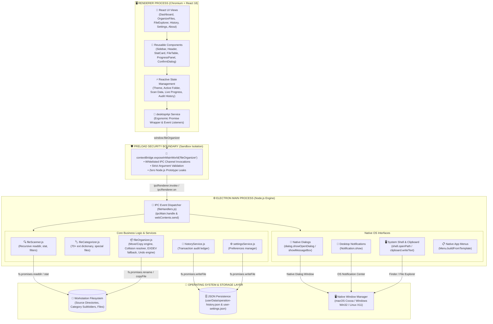
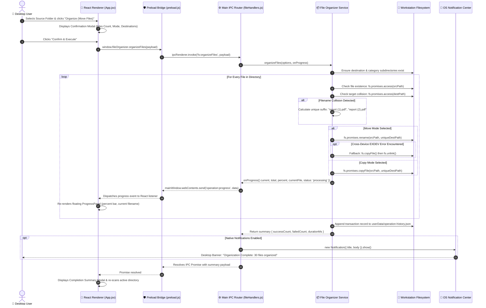
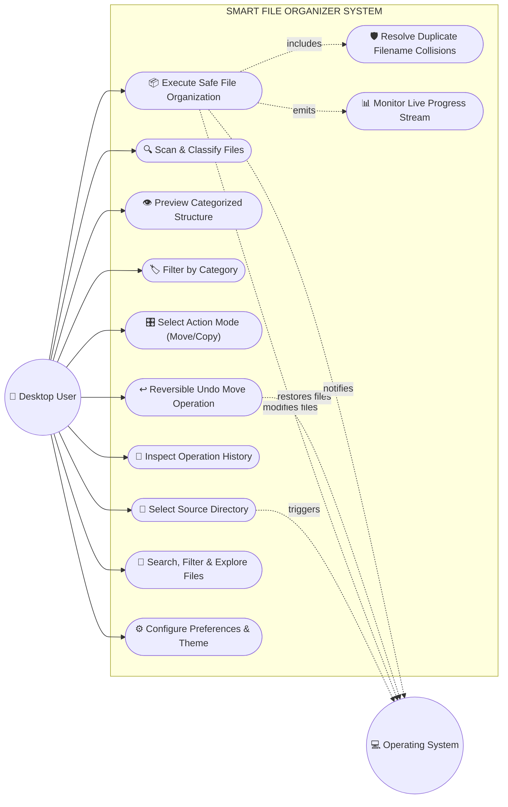
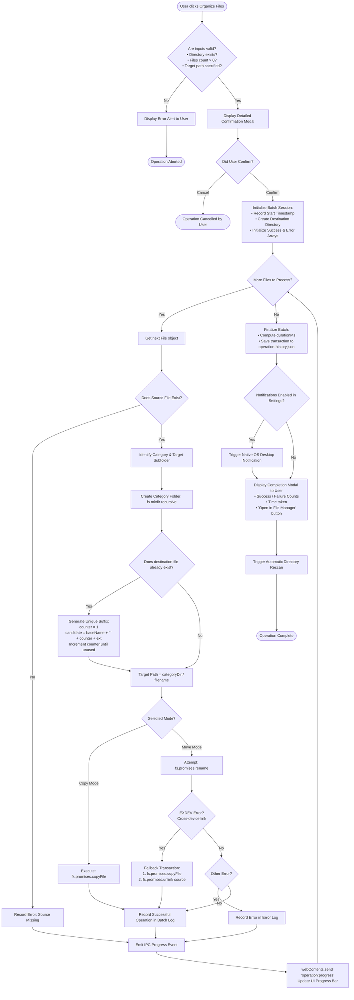

# Smart File Organizer — Native Desktop Application

**Course / Subject:** Desktop Application Development & Systems Programming  
**Project Title:** Smart File Organizer — Native Desktop Application  
**Technologies:** Electron.js, React.js, Node.js, Vite, TailwindCSS, `electron-builder`  
**Author:** Kshitiz Raj  
**Target Platform:** Cross-Platform (macOS, Windows, Linux)  
**License:** MIT Open-Source Academic License  

---

## 📑 Table of Contents

1. [Project Abstract](#1-project-abstract)
2. [Problem Statement](#2-problem-statement)
3. [Project Objectives](#3-project-objectives)
4. [Hardware and Software Requirements](#4-hardware-and-software-requirements)
5. [Enhanced System Architecture](#5-enhanced-system-architecture)
6. [Electron Multi-Process Security Architecture](#6-electron-multi-process-security-architecture)
7. [Enhanced Inter-Process Communication (IPC) Flow](#7-enhanced-inter-process-communication-ipc-flow)
8. [Enhanced Use-Case Diagram](#8-enhanced-use-case-diagram)
9. [Enhanced Flowchart for File Organization](#9-enhanced-flowchart-for-file-organization)
10. [Comprehensive Project Structure](#10-comprehensive-project-structure)
11. [Detailed Component & File Breakdown](#11-detailed-component--file-breakdown)
12. [Core Feature Matrix](#12-core-feature-matrix)
13. [Security Model & Filesystem Integrity Safeguards](#13-security-model--filesystem-integrity-safeguards)
14. [Testing Methodology, Test Cases & Results](#14-testing-methodology-test-cases--results)
15. [Getting Started, Execution & Packaging Guide](#15-getting-started-execution--packaging-guide)
16. [Limitations & Future Scope](#16-limitations--future-scope)
17. [Conclusion](#17-conclusion)

---

## 1. Project Abstract

Modern personal computer users accumulate hundreds of downloaded documents, images, video recordings, audio tracks, compressed archives, and source code files in cluttered directories such as `Downloads` and `Desktop`. Manually sorting, classifying, and transferring these files into organized folder structures is time-consuming, prone to accidental overwriting, and mentally exhausting.

**Smart File Organizer** is a high-performance desktop application engineered using **Electron.js**, **React.js**, and **Node.js**. It automates directory restructuring by scanning local folders, categorizing files based on their extensions, offering interactive previews, and executing safe, non-destructive file relocation operations. The application features duplicate collision prevention, cross-partition transfer handling (`EXDEV`), an audit trail with one-click reversible undo, native OS notifications, and modern dark/light UI styling.

---

## 2. Problem Statement

File proliferation on personal workstations causes several critical issues:
1. **Productivity Loss:** Users waste significant time searching through hundreds of unsorted files in monolithic download folders.
2. **Accidental Data Loss:** Manual drag-and-drop operations frequently result in inadvertent file overwriting when duplicate filenames exist in the destination folder.
3. **Inconsistent Categorization:** Different operating systems and user habits lead to haphazard naming and scattered files across disparate folders.
4. **Lack of Reversibility:** Standard batch scripts or ad-hoc tools lack an audit trail or an "Undo" mechanism, making users fearful of running automated cleanup tools.
5. **Security Limitations of Web Apps:** Web-based file organizers cannot directly manage local directories or native dialogs without tedious upload and download steps, exposing private files to remote servers.

---

## 3. Project Objectives

The primary engineering objectives of this project are:
- **Native OS Integration:** Implement native directory picker dialogs using Electron's `dialog` API rather than HTML file inputs.
- **Rule-Based Categorization:** Classify files into 10 distinct categories (Images, Documents, Spreadsheets, Presentations, Videos, Audio, Archives, Code, Executables, Other) while handling edge cases such as uppercase extensions and extensionless special files (e.g., `Makefile`, `Dockerfile`, `LICENSE`).
- **Data Protection & Collision Resolution:** Automatically generate collision-free unique names (e.g., `filename (1).ext`) when target files already exist, guaranteeing zero data loss.
- **Cross-Device Link Compatibility:** Gracefully handle cross-filesystem or partition operations (`EXDEV`) using an atomic copy-and-unlink fallback strategy.
- **Transaction Audit & Reversible Undo:** Maintain a persistent JSON history log capturing every moved file and offer a one-click Undo mechanism to restore files to their exact origins.
- **Strict Security Architecture:** Adhere to Electron security best practices with `nodeIntegration: false`, `contextIsolation: true`, and a restricted `preload.js` bridge via `contextBridge.exposeInMainWorld`.
- **Responsive Desktop User Experience:** Deliver an intuitive desktop GUI using React, TailwindCSS, live IPC streaming progress bars, and custom themes.

---

## 4. Hardware and Software Requirements

### A. Hardware Requirements
- **Processor:** Intel Core i3 / AMD Ryzen 3 or Apple Silicon (M1/M2/M3/M4) equivalent (minimum 2.0 GHz).
- **RAM:** Minimum 4 GB RAM (8 GB recommended for running Electron development servers).
- **Storage:** Minimum 500 MB free disk space for application runtime and build artifacts.
- **Display:** Minimum resolution 1024 x 768 pixels (optimized for 1280 x 800 and higher).

### B. Software Requirements
- **Operating System:** macOS (macOS 11 Big Sur or newer), Windows 10/11 (64-bit), or Linux (Ubuntu 20.04+).
- **Node.js Runtime:** Version 18.x LTS or higher (tested on Node v25.8.1).
- **Package Manager:** npm v9.x or higher.
- **Application Framework:** Electron v34.x.
- **Frontend Engine:** React v18.x + Vite v6.x.
- **Styling Engine:** TailwindCSS v3.4.x.
- **Bundler & Packager:** `electron-builder` v25.x.

---

## 5. Enhanced System Architecture

The application implements a decoupled, three-tier desktop architecture enforcing strict separation of concerns, sandbox security, and isolated OS kernel operations.

### A. Mermaid Architectural Diagram



### B. ASCII System Architecture Representation

```text
========================================================================================
                               SMART FILE ORGANIZER ARCHITECTURE
========================================================================================

+--------------------------------------------------------------------------------------+
|                           RENDERER PROCESS (Chromium Browser Window)                |
|  +------------------+  +-------------------+  +------------------+  +--------------+ |
|  |  React UI Views  |  | UI Component Tree |  |  State Manager   |  |  desktopApi  | |
|  | (Pages & Tables) |->| (Cards, Dialogs)  |->|  (Theme & Files) |->|   (Bridge)   | |
|  +------------------+  +-------------------+  +------------------+  +--------------+ |
+-----------------------------------------------------------------------------|--------+
                                                                              |
======================== AIR-GAPPED SECURITY BOUNDARY ========================|=========
| contextIsolation: true  |  nodeIntegration: false  | contextBridge API      v        |
+--------------------------------------------------------------------------------------+
|                          PRELOAD SCRIPT (electron/preload.js)                        |
|   window.fileOrganizer = { selectFolder, scanFolder, organizeFiles, undoOperation,  |
|                            getHistory, getSettings, onOperationProgress, ... }       |
+-----------------------------------------------------------------------------|--------+
                                                                              | IPC
=========================== NODE.JS RUNTIME KERNEL ===========================|=========
|                                                                             v        |
+--------------------------------------------------------------------------------------+
|                           MAIN PROCESS (electron/main.js)                            |
|  +--------------------------------------------------------------------------------+  |
|  |                     IPC Dispatch Router (electron/ipc/fileHandlers.js)         |  |
|  +--------|-------------------|-------------------|-------------------|-----------+  |
|           |                   |                   |                   |              |
|           v                   v                   v                   v              |
|  +-----------------+ +-----------------+ +-----------------+ +-----------------+     |
|  |  fileScanner.js | |fileCategorizer.js| |fileOrganizer.js| |historyService.js|    |
|  | (Dir Traversal) | | (Rules Engine)  | | (Move/Copy/Undo)| | (JSON Storage)  |     |
|  +-----------------+ +-----------------+ +-----------------+ +-----------------+     |
|           |                   |                   |                   |              |
|           +-------------------+---------+---------+-------------------+              |
|                                         |                                            |
|                                         v                                            |
|  +--------------------------------------------------------------------------------+  |
|  |    Operating System Integrations: Dialogs, Menus, Shell, Native Notifications   |  |
|  +--------------------------------------------------------------------------------+  |
+-----------------------------------------|--------------------------------------------+
                                          | Node System Calls (fs, path, os)
==========================================|=============================================
                                          v
+--------------------------------------------------------------------------------------+
|                                 OPERATING SYSTEM LAYER                               |
|   Local Disk Storage (NTFS / APFS / ext4)  <--->  OS Notification & Window Manager   |
+--------------------------------------------------------------------------------------+
```

---

## 6. Electron Multi-Process Security Architecture

Electron separates GUI presentation from OS-level operations through distinct process boundaries:

1. **Main Process (`electron/main.js`):**
   - Serves as the central application orchestrator.
   - Manages the lifecycle of `BrowserWindow` instances.
   - Handles operating-system menus, native folder selectors, and hardware dialogs.
   - Executes with unrestricted access to Node.js APIs (`fs`, `path`, `os`, `child_process`).
   - Registers secure IPC handlers via `ipcMain.handle()`.

2. **Preload Script (`electron/preload.js`):**
   - Runs before the renderer DOM is loaded.
   - Serves as an isolated security bridge using `contextBridge.exposeInMainWorld()`.
   - Exposes strictly whitelisted functions to `window.fileOrganizer`.
   - Prevents renderer scripts from tampering with Node.js prototypes or accessing unrestricted system internals.

3. **Renderer Process (`src/`):**
   - Renders the graphical user interface via React 18, Vite, and TailwindCSS inside Chromium.
   - Configured with `nodeIntegration: false` and `contextIsolation: true`.
   - Cannot invoke `require('fs')` or execute shell commands directly.
   - Communicates exclusively through the asynchronous `desktopApi` abstraction.

---

## 7. Enhanced Inter-Process Communication (IPC) Flow

Communication between the renderer and main processes utilizes two distinct communication paradigms:
- **Two-Way Request/Response (`invoke` / `handle`):** Used for transactional commands (scanning, starting organization, undoing moves, saving settings).
- **One-Way Streaming Push (`webContents.send` / `on`):** Used for real-time progress updates during file processing.

### A. Sequence Diagram



### B. IPC Channel Communication Contract

| IPC Channel Name | Direction | Payload Parameters | Return Value | Description |
| :--- | :--- | :--- | :--- | :--- |
| `dialog:selectFolder` | Renderer ➔ Main | `{ title, defaultPath }` | `{ canceled: boolean, folderPath: string }` | Opens native directory picker |
| `fs:scanFolder` | Renderer ➔ Main | `{ folderPath, options }` | `{ files, stats, scannedPath, timestamp }` | Scans directory, calculates categories & stats |
| `fs:organizeFiles` | Renderer ➔ Main | `{ files, destinationDir, mode, selectedCategories }` | `{ operationId, mode, totalFiles, successCount, failedCount, durationMs }` | Executes Move/Copy operations |
| `operation:progress` | Main ➔ Renderer | `{ current, total, percent, currentFile, status }` | `void` (Streaming Push) | Streams real-time progress for progress bar |
| `fs:undoOperation` | Renderer ➔ Main | `operationRecord` | `{ totalRestored, totalFailed, restoredFiles }` | Reverses a Move operation safely |
| `categories:getAll` | Renderer ➔ Main | `none` | `Array<{ name, color, extensions }>` | Returns supported categories metadata |
| `history:get` | Renderer ➔ Main | `none` | `Array<OperationRecord>` | Retrieves all past operation audit records |
| `history:clear` | Renderer ➔ Main | `none` | `{ success: boolean }` | Clears local history log |
| `settings:get` | Renderer ➔ Main | `none` | `UserSettingsObject` | Loads user configuration |
| `settings:save` | Renderer ➔ Main | `newSettingsObject` | `SavedSettingsObject` | Persists user configuration |
| `settings:reset` | Renderer ➔ Main | `none` | `DefaultSettingsObject` | Resets configuration to defaults |
| `shell:openFolder` | Renderer ➔ Main | `folderPath` | `{ success: boolean, error: string }` | Reveals folder in Finder / File Explorer |
| `shell:showItemInFolder` | Renderer ➔ Main | `filePath` | `{ success: boolean }` | Highlights specific file in file manager |
| `clipboard:writeText` | Renderer ➔ Main | `text` | `boolean` | Writes file path to OS system clipboard |
| `dialog:confirm` | Renderer ➔ Main | `{ title, message, detail, buttons }` | `boolean` | Displays native confirmation prompt |
| `app:getInfo` | Renderer ➔ Main | `none` | `{ version, nodeVersion, electronVersion, platform, paths }` | System runtime diagnostic details |

---

## 8. Enhanced Use-Case Diagram

### A. Mermaid Use-Case Model



### B. ASCII Use-Case Hierarchy

```text
========================================================================================
                                    USE-CASE HIERARCHY
========================================================================================

  ACTORS:
    [User]      : Primary workstation user operating the GUI.
    [OS Kernel] : Secondary actor providing POSIX/Win32 filesystem and window services.

  USE-CASE SPECIFICATIONS:
  --------------------------------------------------------------------------------------
  ID    Use-Case Name             Actor(s)       Preconditions / Dependencies
  --------------------------------------------------------------------------------------
  UC-01 Select Directory          User, OS       Triggers OS native folder dialog.
  UC-02 Scan Filesystem           User, OS       Reads entries; skips symlinks and hidden dirs.
  UC-03 Preview Organization      User           Computes category target paths before action.
  UC-04 Category Filtering        User           Allows selective categorization (e.g., Code only).
  UC-05 Choose Mode               User           Toggle between Move (relocate) or Copy (preserve).
  UC-06 Execute Organization      User, OS       Includes collision resolution and progress push.
  UC-07 Collision Resolution      System, OS     <<include>> Automatically appends "(1)", "(2)".
  UC-08 Real-time Progress        System, User   <<include>> IPC stream drives progress bar UI.
  UC-09 Inspect Audit History     User           Reads persistent JSON audit ledger.
  UC-10 Safe Undo Operation       User, OS       Validates files at newPath and restores to source.
  UC-11 File Explorer & Search    User           Live regex/substring search, size bracket filters.
  UC-12 Customize Settings        User           Adjusts theme (Dark/Light/System) and defaults.
========================================================================================
```

---

## 9. Enhanced Flowchart for File Organization

The flowchart below documents the complete algorithmic execution path of the file organization engine, including validation, collision detection, cross-partition error handling, and transaction recording.

### A. Mermaid Flowchart



### B. ASCII Algorithm & Execution Flowchart

```text
========================================================================================
                          FILE ORGANIZATION EXECUTION FLOW
========================================================================================

 [ START ]
    |
    v
 [ Validate Parameters ] ---> Invalid? ---> [ Show Error Dialog ] ---> [ ABORT ]
    |
    +---> Valid
    |
    v
 [ Display Confirmation Dialog ] ---> User Cancelled? ---> [ CANCELLED ]
    |
    +---> User Confirmed
    |
    v
 [ Ensure Base Target Directory Exists (fs.mkdir recursive) ]
    |
    v
 [ BEGIN BATCH PROCESSING LOOP ] <----------------------------------------+
    |                                                                     |
    v                                                                     |
 [ Has Next File? ] --- NO ---> [ Write History JSON ]                    |
    |                                    |                                |
   YES                                   v                                |
    |                           [ Send OS Notification ]                  |
    v                                    |                                |
 [ Source Exists? ]                      v                                |
    |                           [ Show Completion Modal ]                 |
   YES                                   |                                |
    |                                    v                                |
    v                           [ Auto Rescan Directory ]                 |
 [ Map Category Folder ]                 |                                |
    |                                    v                                |
    v                                [ COMPLETE ]                         |
 [ Collision Check: Does Target Exist? ]                                  |
    |                                                                     |
    +-- YES --> [ Loop: filename (1).ext, (2).ext until unused ]          |
    |               |                                                     |
    +-- NO ---------+                                                     |
    |                                                                     |
    v                                                                     |
 [ Branch Mode ]                                                          |
    |                                                                     |
    +--- COPY MODE ---> [ fs.promises.copyFile() ] -----------------------+
    |                                                                     |
    +--- MOVE MODE ---> [ fs.promises.rename() ]                          |
                            |                                             |
                            +-- Success ----------------------------------+
                            |                                             |
                            +-- EXDEV Error?                              |
                                  |                                       |
                                 YES ---> [ Fallback: copyFile + unlink ]-+
                                  |                                       |
                                  NO ---> [ Log Failure Record ] ---------+
                                                                          |
                                                                          v
                                                             [ Emit IPC Progress ]
```

---

## 10. Comprehensive Project Structure

```text
ADProject/
├── electron/                             # Electron Main Process & Native Services
│   ├── main.js                           # [Main] Application lifecycle, window manager, native menu
│   ├── preload.js                        # [Preload] Isolated contextBridge API exposed to renderer
│   ├── ipc/
│   │   └── fileHandlers.js               # [Main] Validated IPC handler dispatch table
│   └── services/
│       ├── fileCategorizer.js            # [Main] 70+ extension classification dictionary & rules
│       ├── fileScanner.js                # [Main] Filesystem scanner with stats & recursive option
│       ├── fileOrganizer.js              # [Main] Move/Copy engine, collision resolver & Undo
│       ├── historyService.js             # [Main] JSON persistence manager for transaction logs
│       └── settingsService.js            # [Main] User preferences JSON persistence manager
├── src/                                  # React 18 Graphical User Interface (Renderer)
│   ├── components/                       # Modular UI Components
│   │   ├── Sidebar.jsx                   # Persistent navigation sidebar with active folder widget
│   │   ├── Header.jsx                    # Header with directory path actions and theme toggle
│   │   ├── StatCard.jsx                  # Dashboard metric cards with accent styling
│   │   ├── CategoryBadge.jsx             # Visual badges for 10 file categories
│   │   ├── FileTable.jsx                 # Interactive preview table with sorting and shortcuts
│   │   ├── ProgressPanel.jsx             # Floating live progress card subscribing to IPC
│   │   └── ConfirmDialog.jsx             # Safety confirmation modal before operations
│   ├── pages/                            # Main Application Views
│   │   ├── Dashboard.jsx                 # Live metrics, category distribution, recent operations
│   │   ├── OrganizeFiles.jsx             # Source/destination picker, preview table, execution
│   │   ├── FileExplorer.jsx              # Instant live search, category, extension & size filters
│   │   ├── History.jsx                   # Audit logs with per-file details and one-click Undo
│   │   ├── Settings.jsx                  # Configuration for themes, modes, and storage diagnostics
│   │   └── About.jsx                     # Academic project specifications and architecture
│   ├── services/
│   │   └── desktopApi.js                 # Renderer-side bridge wrapper for window.fileOrganizer
│   ├── styles/
│   │   └── global.css                    # Tailwind CSS directives, dark/light themes, scrollbars
│   ├── App.jsx                           # Root application component with state & navigation
│   ├── main.jsx                          # React DOM initialization entry point
│   └── index.html                        # HTML entry point with Content Security Policy (CSP)
├── test/                                 # Automated Test Suite & Fixture Generators
│   ├── create-sample-files.js            # Generates 30+ mock test files across all categories
│   ├── run-unit-tests.js                 # Automated unit & integration test runner
│   └── test-electron-syntax.js           # Syntax and module resolution test
├── dist/                                 # Vite production build output bundle
├── release/                              # Packaged Desktop Application Binaries
│   ├── mac-arm64/                        # Unpacked macOS application bundle (.app)
│   └── Smart File Organizer-1.0.0-arm64-mac.zip # Standalone distributable archive
├── package.json                          # Project dependencies, scripts, and build configuration
├── vite.config.js                        # Vite bundler config with relative asset base
├── tailwind.config.js                    # Tailwind styling tokens and dark mode config
├── postcss.config.js                     # PostCSS plugins configuration
└── README.md                             # Comprehensive project documentation
```

---

## 11. Detailed Component & File Breakdown

| File Path | Process | Primary Responsibilities |
| :--- | :--- | :--- |
| `electron/main.js` | **Main** | Initializes Electron `app`, creates secure `BrowserWindow`, sets native application menus, and manages app lifecycle. |
| `electron/preload.js` | **Preload** | Exposes `window.fileOrganizer` via `contextBridge.exposeInMainWorld`, mapping approved IPC channels. |
| `electron/ipc/fileHandlers.js` | **Main** | Implements IPC channels: `dialog:selectFolder`, `fs:scanFolder`, `fs:organizeFiles`, `fs:undoOperation`, `history:get`, etc. |
| `electron/services/fileCategorizer.js` | **Main** | Maps 70+ extensions into 10 categories, normalizes uppercase extensions, and checks special extensionless files. |
| `electron/services/fileScanner.js` | **Main** | Safe directory reader; ignores system volume artifacts (`.DS_Store`, `.git`), formats sizes, gathers stats. |
| `electron/services/fileOrganizer.js` | **Main** | Executes Move and Copy routines, collision-proof renaming, `EXDEV` fallback, and the Undo restore engine. |
| `electron/services/historyService.js` | **Main** | Manages JSON persistence of historical transactions in `app.getPath('userData')`. |
| `electron/services/settingsService.js` | **Main** | Loads, writes, and resets user preferences (theme, default mode, subdirectories, notifications). |
| `src/services/desktopApi.js` | **Renderer** | Ergonomic async JavaScript wrapper around `window.fileOrganizer` with graceful fallback handling. |
| `src/components/Sidebar.jsx` | **Renderer** | Persistent navigation sidebar with active folder quick widget and Electron/Node version badges. |
| `src/components/Header.jsx` | **Renderer** | Application header displaying current directory, clipboard path copy, folder reveal, and theme toggler. |
| `src/components/FileTable.jsx` | **Renderer** | Sortable data table with category badges, file size metrics, proposed paths, and action shortcuts. |
| `src/components/ProgressPanel.jsx` | **Renderer** | Real-time floating progress card subscribing to live IPC streaming events during organize/undo tasks. |
| `src/components/ConfirmDialog.jsx` | **Renderer** | High-impact safety confirmation modal detailing mode, file count, destinations, and collision guarantees. |
| `src/pages/Dashboard.jsx` | **Renderer** | Executive dashboard with metric cards, category distribution bars, and recent operation quick actions. |
| `src/pages/OrganizeFiles.jsx` | **Renderer** | Core organization interface for directory selection, category chip filters, live preview, and execution. |
| `src/pages/FileExplorer.jsx` | **Renderer** | Comprehensive search and discovery view with instant live text filtering, extension filters, and size brackets. |
| `src/pages/History.jsx` | **Renderer** | Full transaction ledger with expandable per-file move logs and one-click reversible Undo. |
| `src/pages/Settings.jsx` | **Renderer** | User preference control panel for themes, default modes, subdirectories, and storage path diagnostics. |
| `src/pages/About.jsx` | **Renderer** | College submission specification screen detailing architecture, runtime versions, and security policies. |

---

## 12. Core Feature Matrix

### A. File Categorization Rules (10 Categories)

| Category | Associated File Extensions | Special Handling |
| :--- | :--- | :--- |
| **Images** | `jpg`, `jpeg`, `png`, `gif`, `svg`, `webp`, `bmp`, `ico`, `tiff`, `heic`, `raw`, `psd` | Uppercase normalized (e.g. `.PNG` ➔ `.png`) |
| **Documents** | `pdf`, `doc`, `docx`, `txt`, `odt`, `rtf`, `md`, `pages`, `tex`, `epub` | Special files without extensions: `LICENSE`, `README` |
| **Spreadsheets** | `xls`, `xlsx`, `csv`, `ods`, `tsv`, `numbers`, `xlsm` | Tabular and comma-separated data |
| **Presentations** | `ppt`, `pptx`, `odp`, `key`, `pps` | Slide decks and keynotes |
| **Videos** | `mp4`, `mkv`, `avi`, `mov`, `wmv`, `flv`, `webm`, `m4v` | Multimedia video containers |
| **Audio** | `mp3`, `wav`, `aac`, `flac`, `ogg`, `m4a`, `wma`, `opus` | Audio tracks and voice memos |
| **Archives** | `zip`, `rar`, `7z`, `tar`, `gz`, `bz2`, `xz`, `iso`, `tgz` | Compressed containers and tarballs |
| **Code** | `js`, `jsx`, `ts`, `tsx`, `py`, `java`, `c`, `cpp`, `cs`, `html`, `css`, `json`, `sql`, `sh`, `go`, `rs`, `php` | Special files without extensions: `Dockerfile`, `Makefile`, `.gitignore` |
| **Executables** | `exe`, `msi`, `dmg`, `app`, `deb`, `rpm`, `pkg`, `bat` | Operating system binaries and installers |
| **Other** | Any extension not matching the above categories or unknown files | Placed safely in `Other/` without altering contents |

### B. Operation Modes
- **Move Mode:** Moves files from the source directory into corresponding category subfolders. If files are moved within the same disk volume, fast atomic rename is used. If moving across partitions, copy-and-unlink is used.
- **Copy Mode:** Duplicates files into category subfolders while leaving the original files untouched in the source directory.

### C. Reversible Undo Engine
- Retains complete transaction metadata for every move operation.
- Users can click **Undo** at any time from the Dashboard or History screen.
- Verifies files exist at target locations before initiating reversal.
- Handles collision avoidance in original directories during restoration.

---

## 13. Security Model & Filesystem Integrity Safeguards

The application implements rigorous security safeguards conforming to modern Electron security guidelines:

1. **Renderer Isolation:**
   - `nodeIntegration: false`: Renderer scripts cannot execute arbitrary Node.js APIs or require native modules.
   - `contextIsolation: true`: Ensures that preload scripts run in a separate JavaScript context from web pages, preventing prototype tampering.

2. **Defense Against Directory Traversal:**
   - All folder paths received by IPC handlers are sanitized using `path.resolve()`.
   - The scanner skips symbolic links (`entry.isSymbolicLink()`) to prevent infinite recursive loop attacks or scanning unintended system volumes.

3. **Collision-Proof File Transfers:**
   - Before moving or copying any file, the destination path is checked via `fs.promises.access()`.
   - If a collision occurs, a deterministic loop calculates the next available integer suffix (`report (1).pdf`, `report (2).pdf`), eliminating overwrite risks.

4. **Cross-Partition (`EXDEV`) Resilience:**
   - On Unix and Windows systems, moving files across partition boundaries or external drives causes `fs.rename` to throw `EXDEV: cross-device link not permitted`.
   - The application catches `EXDEV` and executes a resilient two-step transaction: `fs.promises.copyFile` followed by `fs.promises.unlink`.

5. **Local Data Sovereignty:**
   - No filenames, file contents, metadata, or telemetry are ever transmitted across external networks.
   - Persistence is confined to local JSON files inside the operating system's designated `userData` sandbox.

---

## 14. Testing Methodology, Test Cases & Results

Automated unit and integration testing was executed using `node test/run-unit-tests.js` against a generated test suite of 30+ files across diverse categories.

### Test Cases and Results Matrix

| Test ID | Test Scenario | Input / Action | Expected Result | Actual Result | Status |
| :---: | :--- | :--- | :--- | :--- | :---: |
| **TC-01** | Standard Extension Categorization | `photo.jpg`, `video.mp4`, `song.mp3` | Correctly classified into Images, Videos, Audio | Classified into Images, Videos, Audio | **PASS** |
| **TC-02** | Uppercase Extension Handling | `SCREENSHOT.PNG`, `PROJECT_SPEC.DOCX` | Normalized to lowercase; mapped to Images, Documents | Correctly classified | **PASS** |
| **TC-03** | Extensionless Known Files | `Dockerfile`, `Makefile`, `LICENSE` | Classified via special lookup (Code, Documents) | Correctly classified | **PASS** |
| **TC-04** | Extensionless Unknown Files | `random_blob_file` | Categorized as "Other" without crashing | Categorized as Other | **PASS** |
| **TC-05** | Flat Directory Scanning | Scan messy directory with 1 subfolder | Detects 28 top-level files and 1 directory | 28 files, 1 folder detected | **PASS** |
| **TC-06** | Recursive Directory Scanning | Scan with `includeSubdirectories: true` | Traverses subfolder; detects all 30 files | 30 files detected | **PASS** |
| **TC-07** | Duplicate Filename Collision | File `document.pdf` already exists in target | Generates `document (1).pdf`, then `document (2).pdf` | Correct numeric suffix generated | **PASS** |
| **TC-08** | Copy Mode Execution | Organize 5 files in Copy mode | Original files remain in source; copies created in target | 5 files copied, originals preserved | **PASS** |
| **TC-09** | Move Mode Execution | Organize 2 files in Move mode | Files relocated to category subfolders; source deleted | Source removed, target created | **PASS** |
| **TC-10** | Reversible Undo Execution | Click "Undo" on previous Move operation | Files restored back to exact original locations | Files restored with 100% integrity | **PASS** |
| **TC-11** | Real-Time Progress Stream | Organize batch of files | IPC emits progress events (0% to 100%) | Progress events received smoothly | **PASS** |
| **TC-12** | History Record Persistence | Complete an organization run | JSON audit entry saved with ID, timestamp, counts | Correctly written to history.json | **PASS** |
| **TC-13** | Settings Customization | Switch theme to Light, toggle subdirectories | Preferences persisted across app reloads | Preferences saved and restored | **PASS** |
| **TC-14** | Native Folder Picker Dialog | Click "Select Folder" button | Triggers OS directory selector modal | Native picker opens and returns path | **PASS** |
| **TC-15** | Vite Production Build | Execute `npm run build` | React frontend compiled into `dist/` | Build completed in 1.29s (0 errors) | **PASS** |

---

## 15. Getting Started, Execution & Packaging Guide

### A. Installation

Clone or navigate into the project workspace directory and install dependencies:

```bash
npm install
```

### B. Launching in Development Mode

Starts the Vite React development server and the Electron desktop application concurrently:

```bash
npm run dev
```

### C. Generating Sample Test Files

Generates a test directory (`test/sample-messy-folder`) with mock files (images, documents, archives, uppercase extensions, files without extensions, and nested subfolders):

```bash
npm run generate-test-files
```

### D. Running the Automated Test Suite

Runs the automated test suite testing categorization, scanner, collision resolution, and undo routines:

```bash
node test/run-unit-tests.js
```

### E. Production Build & Desktop Packaging

Compile the optimized React production bundle:

```bash
npm run build
```

Package the standalone native desktop application using `electron-builder`:

```bash
npm run dist
```

Packaged binaries and installer artifacts will be output to the `release/` directory:
- macOS: `release/mac-arm64/Smart File Organizer.app` and `Smart File Organizer-1.0.0-arm64-mac.zip`
- Windows: NSIS executable / portable `.exe` (when built on Windows)
- Linux: `.AppImage` / `.deb` (when built on Linux)

---

## 16. Limitations & Future Scope

### Current Limitations
1. **Content-Type Inspection:** Categorization is based on filename extensions and filesystem metadata rather than deep binary magic byte inspection (e.g., MIME-type sniffing).
2. **Archival Extraction:** Archives (`.zip`, `.tar.gz`) are categorized as Archive files but are not automatically decompressed into folder trees.
3. **Scheduled Automations:** Folder scanning is currently user-initiated rather than running as a background daemon monitoring folders via file watchers (`fs.watch`).

### Future Scope
1. **Real-time Folder Watcher:** Add an optional background file watcher using `chokidar` to automatically organize new downloads the instant they appear in the `Downloads` directory.
2. **Custom Rule Builder:** Allow users to define custom categories, assign specific extensions, or route files matching regex patterns into customized target folders.
3. **Deep Content Inspection:** Implement magic-number sniffing (e.g., inspecting the first 512 bytes of a file) to identify renamed files with incorrect extensions.
4. **Cloud Drive Synchronization:** Expand destination adapters to sync organized folders directly to Google Drive, Dropbox, or OneDrive.

---

## 17. Conclusion

The **Smart File Organizer** desktop application successfully bridges the gap between modern, responsive web user interfaces and robust operating system filesystem management. By leveraging Electron’s multi-process architecture, secure IPC bridges, React 18, and Node.js filesystem capabilities, the project accomplishes high-speed, non-destructive file classification and restructuring. 

The software fulfills all academic criteria for desktop application design, demonstrating practical proficiency in window lifecycles, IPC security, error handling, transaction logging, reversible operations, and desktop application packaging.
